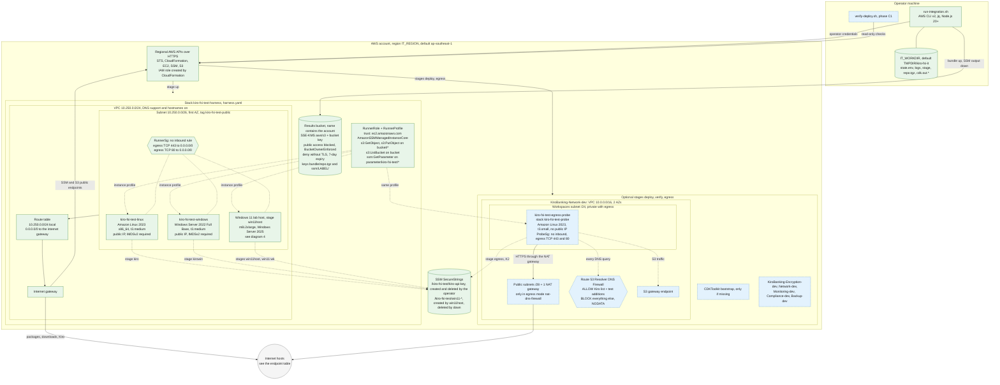
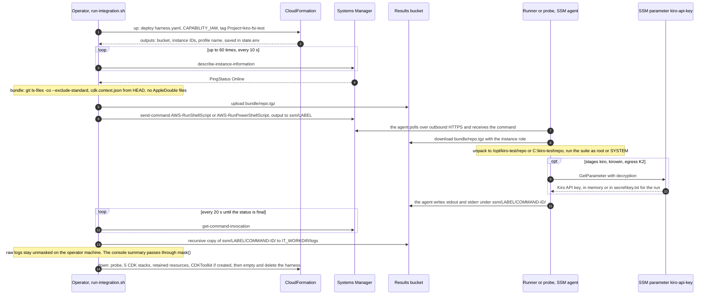
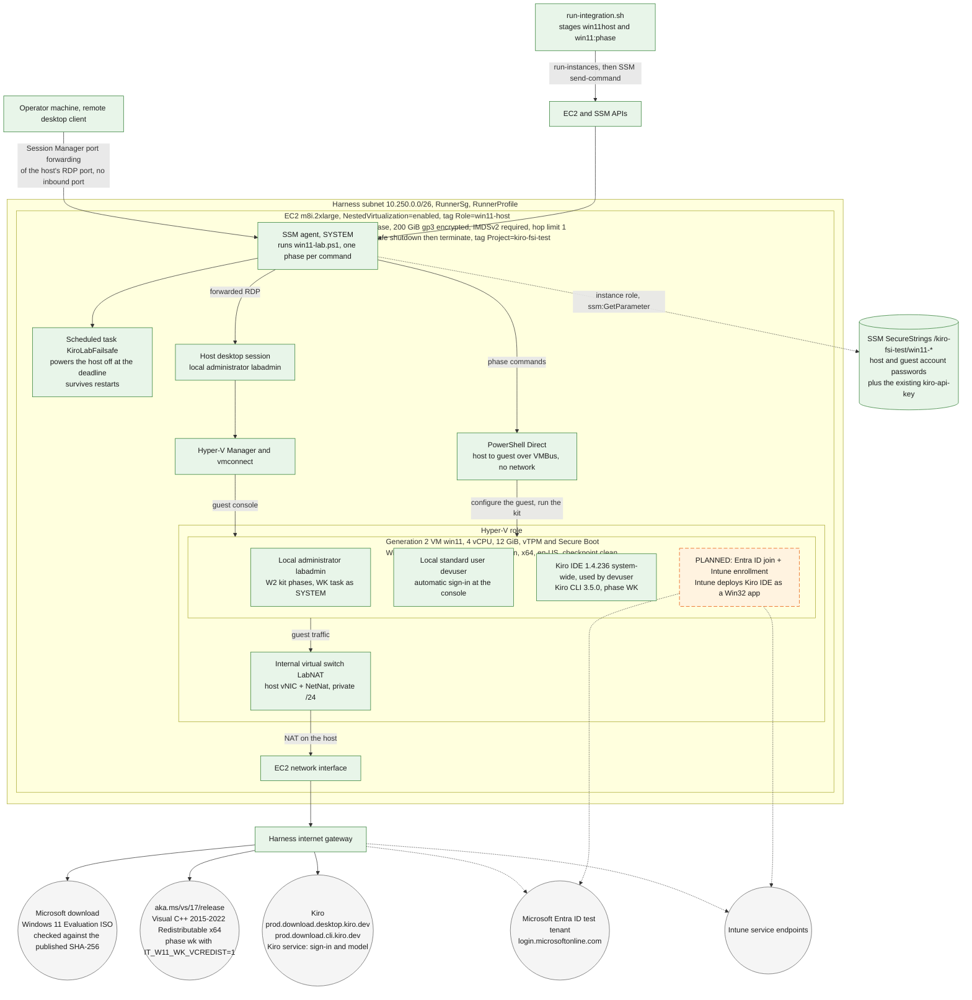

# AWS integration test: architecture

This page draws the integration-test environment of this folder as the code builds it: network, servers, identities, data paths and external endpoints. The operator machine drives everything through AWS APIs. [`harness.yaml`](harness.yaml) creates one isolated VPC with a Linux runner and a Windows runner. Neither runner accepts an inbound connection. Commands reach them only through AWS Systems Manager (SSM), and results come back through a short-lived S3 bucket. The optional `deploy`, `verify` and `egress` stages add the repository's five CDK stacks and an egress probe behind the DNS Firewall. The last diagram shows the Windows 11 lab host that the opt-in stages `win11host` and `win11:<phase>` build with [`win11-lab.ps1`](win11-lab.ps1). It was built and used on 2026-11-19 and 2026-11-20.

Every element is traced to a file and line in the tables. What the code does not do (an Entra ID join and an Intune enrollment of the guest) is marked PLANNED. Where the code and the README differ, the drawing follows the code. The differences are listed in [Notes and discrepancies](#notes-and-discrepancies).

**Sanitized.** The page has no account IDs, instance IDs, bucket names, SSM command IDs or IP addresses. The only addresses are the CIDRs in the templates and the CDK configuration. The private range of the lab's internal Hyper-V switch is set in `win11-lab.ps1` and left out here. Placeholders: `<account>`, `<region>`, `<bucket>`, `LABEL`, `COMMAND-ID`.

## Legend

| Mark | Meaning | In the diagrams |
|---|---|---|
| **Used 2026-11-19/20** | Built and used in the runs recorded on 2026-11-19 and 2026-11-20 ([evidence](../../kiro-docs/aws-integration-test-evidence.md#run-of-2026-11-19-v110-windows-and-intune), [later runs](../../kiro-docs/aws-integration-test-evidence.md#runs-of-2026-11-19-later-and-2026-11-20-windows-11-kiro-ide-and-kiro-cli)) | green, solid border |
| **Optional** | In the code, but not run on 2026-11-19 or 2026-11-20: stages `deploy`, `verify`, `egress`, and the fallback install of Kiro CLI by the test user | blue, dashed border |
| **PLANNED** | Not in the code: the Entra ID join and the Intune enrollment of the Windows 11 guest | orange, long dashes, the word PLANNED |
| External | Hosts outside the AWS account | grey |

What ran on 2026-11-19 and 2026-11-20 ([evidence](../../kiro-docs/aws-integration-test-evidence.md)). Five harnesses were created. The first four were torn down on 2026-11-19. The fifth carried phase WK, K1/K2 and the Windows 11 lab host; its teardown is not recorded in the evidence. No CDK stack was deployed. The API key parameter existed for the fifth harness only.

| Harness | Time (UTC) | Stages recorded | Phases |
|---|---|---|---|
| 1 | 02:36 to 05:39 | `up`, `bundle`, `linux`, `windows` (nine runs), `down`, `leftovers` | L1, L2, L3, W1, W3, W4 |
| 2 | 06:59 to 07:46 | `windows`, `client` (WC runs 1 to 5), `down`, `leftovers` | W1, W3, W4, WC |
| 3 | 08:15 to 08:58 | `client` (WC runs 6 to 10), `windows`, `down`, `leftovers` | WC, W1, W3, W4 |
| 4 | 08:59 to 09:29 | `windows`, `client` (WC run 11), `down`, `leftovers` | W1, W3, W4, WC |
| 5 | from 14:08 on 2026-11-19, into 2026-11-20 | `up`, `bundle`, `kirowin` (WK runs 1 to 4 and a follow-up run), `kiro`, `win11host`, `win11:<phase>` (`host`, `iso`, `vm`, `kit-baseline`, `kit-install`, `kit-policy`, `wk` three times) | WK, K1, K2, W11, W2 in the VM, WK in the VM |

Every harness creates the Linux runner too (`harness.yaml:155`, no condition), but the evidence records Linux phases on harnesses 1 and 5 only. Not run on 2026-11-19 or 2026-11-20: `deploy` (C1 deployment), `verify` (C1), `egress` (C2, and K1/K2 behind the allowlist). C1 and C2 last ran on 2026-10-10. The manual W2 checklist with Kiro IDE in the VM was done by a person at the VM console, not by a stage.

## Diagram 1: AWS account view

### Network

| Element | Value | Source |
|---|---|---|
| Region | `IT_REGION`, default `ap-southeast-1`. An inherited `AWS_REGION` is ignored | `run-integration.sh:55` |
| VPC | `10.250.0.0/24`, DNS support and DNS hostnames on, tag `Name=kiro-fsi-test-vpc` | `harness.yaml:71-77` |
| Subnet | `10.250.0.0/26`, the first AZ that `!GetAZs` returns, `MapPublicIpOnLaunch: false`, tag `Name=kiro-fsi-test-public` | `harness.yaml:88-95` |
| Internet gateway | Attached to the VPC | `harness.yaml:79-86` |
| Route table | `0.0.0.0/0` to the internet gateway, plus the implicit local route. Associated with the subnet | `harness.yaml:97-110` |
| Network ACL | None in the template, so the VPC default ACL applies (allows all) | `harness.yaml` (no `NetworkAcl` resource) |
| Security group `RunnerSg` | **No inbound rule.** Egress TCP 443 to `0.0.0.0/0` ("HTTPS (SSM, S3, package registries)"). Egress TCP 80 to `0.0.0.0/0` ("HTTP (OS package mirrors)"). No other egress | `harness.yaml:112-120` |
| Public IP | Each runner network interface gets `AssociatePublicIpAddress: true`. It is used for outbound traffic only, because there is no inbound rule | `harness.yaml:163-167`, `190-194` |

### Identities

| Identity | Exact permissions | Used by | Source |
|---|---|---|---|
| Operator credentials (AWS CLI profile or environment) | Whatever the operator's role allows. The stages call STS, CloudFormation, EC2, SSM and S3. `preflight` also reads GuardDuty, Security Hub, Access Analyzer, Config and Organizations. `deploy` and `down` use the CDK bootstrap and the CloudFormation execution role `cdk-hnb659fds-cfn-exec-role-<account>-<region>`. `down` and `leftovers` also call KMS, CloudWatch Logs, Backup, ECR, the Resource Groups Tagging API, SNS, CloudWatch, CloudTrail, EventBridge, Route 53 Resolver and IAM (list only) | `run-integration.sh` on the operator machine | `run-integration.sh:130-145`, `241-263`, `387-490` |
| `RunnerRole`, through the instance profile `RunnerProfile` | Trust: `ec2.amazonaws.com`, `sts:AssumeRole`. Managed policy `AmazonSSMManagedInstanceCore`. Inline policy `results-bucket-and-test-parameters`: `s3:GetObject` and `s3:PutObject` on `<bucket>/*`, `s3:ListBucket` on `<bucket>`, `ssm:GetParameter` on `arn:<partition>:ssm:<region>:<account>:parameter/kiro-fsi-test/*`. No deploy permissions, no `kms:Decrypt` | Linux runner, Windows runner, egress probe (`InstanceProfileName=$PROFILE_NAME`), Windows 11 lab host (`--iam-instance-profile`) | `harness.yaml:123-152`, `run-integration.sh:363`, `332-333` |
| Results bucket policy | One statement: deny `s3:*` to everyone when `aws:SecureTransport` is false | Everyone | `harness.yaml:56-68` |
| SSM SecureString `/kiro-fsi-test/kiro-api-key` | Not created by any script. The operator creates and deletes it. `leftovers` reports it while it exists | Read with decryption by the stages `kiro` (Linux runner), `kirowin` (Windows runner) `egress` (probe, K2) and `win11:wk` (lab host, which hands it into the VM as a file) | `run-integration.sh:20-24`, `49`, `464`; `linux-suite.sh:179`; `windows-kiro-cli-suite.ps1:597-605`; `win11-lab.ps1:385`, `425-427`, `450` |
| SSM SecureStrings `/kiro-fsi-test/win11-host-admin`, `win11-guest-admin`, `win11-guest-user` | Random passwords that `win11host` creates when they are missing and never prints. `down` deletes every parameter under `/kiro-fsi-test/win11-` | Read with decryption on the lab host by `win11-lab.ps1`: the host's `labadmin` (phase `host`), the guest's `labadmin` and `devuser` (phase `vm`), and the PowerShell Direct sessions as the guest's `labadmin` | `run-integration.sh:311-318`, `326`, `393-395`; `win11-lab.ps1:62-67`, `93`, `156`, `326`, `384` |

### Servers in this view

The full table is in [Servers](#servers). The runners differ only in AMI, root volume and tags. Both use the `InstanceType` parameter (default `t3.medium`), and `st_up` passes no parameter overrides (`run-integration.sh:147-148`).

### CDK stacks and the probe (optional stages)

Kept at stack level. `deploy` bootstraps CDK if `CDKToolkit` is missing, synthesizes offline and deploys the five stacks with the AWS CLI through the bootstrap bucket `cdk-hnb659fds-assets-<account>-<region>` and the CloudFormation execution role (`run-integration.sh:224-270`). `egress` redeploys them with `-c egress=nat-dns-firewall` and test-only allowlist additions, then launches the probe in the first subnet tagged `aws-cdk:subnet-name=Workspaces` (`run-integration.sh:353-369`).

| Element | Value | Source |
|---|---|---|
| Stacks | `KiroBanking-Encryption-dev`, `KiroBanking-Network-dev`, `KiroBanking-Monitoring-dev`, `KiroBanking-Compliance-dev`, `KiroBanking-Backup-dev` | `run-integration.sh:59-60` |
| CDK VPC (dev) | `10.0.0.0/16`, 2 AZs. Workspaces `/24` x2, Endpoints `/24` x2, and in `nat-dns-firewall` mode Public `/28` x2 with one NAT gateway | `cdk/config/environments.ts:137`, `cdk/lib/stacks/network-stack.ts:42-47`, `111-140` |
| DNS Firewall | Domain list `kiro-banking-egress-allow-dev` (Kiro list, private endpoint names, `egressAllowedDomains`): ALLOW, priority 100, trust redirection domains. List `*`: BLOCK with NODATA, priority 200. Associated with the CDK VPC, priority 101 | `network-stack.ts:425-492` |
| Test-only allowlist additions | `ssm.<region>.amazonaws.com`, `ssmmessages.<region>.amazonaws.com`, `ec2messages.<region>.amazonaws.com`, `s3.<region>.amazonaws.com`, `<bucket>.s3.<region>.amazonaws.com`, `cdn.amazonlinux.com`, `*.s3.dualstack.<region>.amazonaws.com` | `run-integration.sh:356` |
| Probe path | No public IP. HTTPS goes through the NAT gateway. Names resolve only through the DNS Firewall. S3 traffic uses the S3 gateway endpoint of the CDK VPC | `probe.yaml:41`, `network-stack.ts:302-304`, `338-348` |
| Probe security group `ProbeSg` | No inbound rule. Egress TCP 443 ("HTTPS") and TCP 80 ("HTTP (negative tests)") to `0.0.0.0/0` | `probe.yaml:19-27` |

## Diagram 2: control and data paths

| Step | What the code does | Source |
|---|---|---|
| State file | `IT_WORKDIR/state.env` (default `$TMPDIR/kiro-fsi-it`). Keys: `ACCOUNT`, `HAS_GD`, `HAS_SH`, `HAS_AA`, `HAS_REC`, `HAS_BOOT`, `BUCKET`, `LINUX_ID`, `WIN_ID`, `PROFILE_NAME`, `PROBE_ID`, `WE_BOOTSTRAPPED`, `W11_ID`, `W11_DEADLINE`. Never committed | `run-integration.sh:57-67`, `132-138`, `149-150`, `266`, `341-342`, `364` |
| Stack names | `kiro-fsi-test-harness`, `kiro-fsi-test-probe`, the five `KiroBanking-*-dev` stacks, and `CDKToolkit` | `run-integration.sh:59-60`, `138` |
| Online wait | Up to 60 checks, 10 s apart, until `PingStatus` is `Online` | `run-integration.sh:73-80` |
| Bundle | Tracked and untracked files that are not ignored, staged in `IT_WORKDIR/stage`. `cdk/cdk.context.json` comes from `HEAD`. Packed without macOS metadata, refused if it holds `._` files. Uploaded to `s3://<bucket>/bundle/repo.tgz` | `run-integration.sh:153-167` |
| Command | `aws ssm send-command`: delivery timeout 600 s, comment `kiro-fsi-test LABEL`, `--output-s3-bucket-name <bucket>`, prefix `ssm/LABEL`, `executionTimeout` per stage (900 to 5400 s) | `run-integration.sh:81-87` |
| Linux runner pulls | `aws s3 cp s3://<bucket>/bundle/repo.tgz` into `/opt/kiro-test`, unpack to `/opt/kiro-test/repo`, run `linux-suite.sh <phase>` as root | `run-integration.sh:104-113` |
| Windows runner pulls | `Read-S3Object` into `C:\kiro-test\repo.tgz`, `tar.exe` to `C:\kiro-test\repo`, then `powershell.exe -File <suite>` as SYSTEM | `run-integration.sh:114-127` |
| Results | The SSM agent writes the output under `ssm/LABEL/COMMAND-ID/`. The operator polls every 20 s, then copies the prefix to `IT_WORKDIR/logs/LABEL/COMMAND-ID/` and joins `LABEL.stdout` and `LABEL.stderr` | `run-integration.sh:89-99` |
| Labels | `linux-setup`, `linux-L1`, `linux-L2`, `linux-L3`, `linux-
`, `windows`, `windows-client`, `windows-kiro-cli`, `windows-kiro-cli-cleanup`, `linux-kiro`, `win11-<phase>`, `probe-setup`, `probe-C2`, `probe-kiro` | `run-integration.sh:169-170`, `174`, `186`, `295-308`, `350`, `366-368`, `504` |
| Bucket lifetime | Objects expire after 7 days. `down` empties the bucket before the harness is deleted | `harness.yaml:49-53`, `run-integration.sh:423-427` |

Masking of identifiers:

| Where | What is replaced | Source |
|---|---|---|
| Orchestrator console summary (`mask()`) | 12 digits in a row to `<account>`. `i-<hex>` to `<instance>`. `vpc-`, `subnet-`, `sg-`, `acl-`, `vpce-`, `nat-`, `igw-`, `rtb-`, `fl-`, `eni-`, `eipalloc-`, `vol-` IDs to `<type>-<id>`. IPv4 addresses to `<ip>`. Applied to the printed `CHECK` and `PHASE` lines, the identity line and the leftover scan. The raw logs under `IT_WORKDIR/logs` are not masked | `run-integration.sh:70`, `101`, `133`, `189`, `302`, `485` |
| `windows-kiro-cli-suite.ps1` output | The API key (exact value and `ksk_...`), the computer name, 12 digits in a row, ANSI escapes and non-ASCII characters | `windows-kiro-cli-suite.ps1:67-78` |
| `linux-suite.sh` K2 log tails | `ksk_...` and `sk-...` tokens | `linux-suite.sh:274` |
| W2 kit | SIDs, user names, the computer name and the domain name, unless `-NoSanitize` | `security-tests/windows-client/README.md:266` |

## Diagram 3: inside the Windows runner

```mermaid
flowchart TB
  classDef used fill:#e8f5e9,stroke:#2e7d32,color:#1b1b1b
  classDef optional fill:#e3f2fd,stroke:#1565c0,color:#1b1b1b,stroke-dasharray:4 3
  classDef ext fill:#f5f5f5,stroke:#616161,color:#1b1b1b

  SSMA["SSM agent service, LocalSystem"] --> PS["powershell.exe 5.1 as SYSTEM, session 0<br/>pulls the bundle, runs one suite per stage"]

  subgraph SYS["Runs as SYSTEM"]
    W["windows stage: windows-suite.ps1<br/>W1, W3, W4 under PowerShell 5.1 and 7<br/>32-bit powershell.exe for the Win32 install command"]
    C["client stage: windows-client-suite.ps1<br/>W2 kit Invoke-W2Checks.ps1 as SYSTEM"]
    IDE["Kiro IDE system-wide installer, Inno Setup<br/>only if the signature gate passes<br/>default switches include /MERGETASKS=!runcode"]
    K["kirowin stage: windows-kiro-cli-suite.ps1<br/>download, signature gate, msiexec as SYSTEM<br/>policy deploy, creates kirotest, reads the API key"]
    MSI["msiexec /i kiro-cli MSI /quiet /norestart<br/>a: default folder, then uninstalled<br/>b: INSTALLFOLDER=C:\Program Files\Kiro-Cli"]
    LOCK["mdm\lockdown-windows.ps1<br/>-StageSources -DeployHooks -InstallUser -DisableUpdates"]
    TS["One-shot scheduled task KiroWK-xxxxxxxx<br/>RunLevel Limited, removed after each run"]
  end

  subgraph USR["Runs as kirotest: local standard user, Users group only"]
    JOB["powershell.exe -File C:\kiro-test\wk\jobs\NAME.ps1"]
    CLI["kiro-cli chat --v3 --no-interactive<br/>with or without --trust-all-tools<br/>cwd C:\kiro-test\wk\work<br/>KIRO_API_KEY from secret\key.txt"]
    SH["Agent shell commands, PowerShell<br/>Set-Content, Invoke-WebRequest, irm,<br/>Remove-Item, nested powershell"]
    HK["Hook commands started by kiro-cli<br/>through cmd.exe, measured by W2.8.probe<br/>not documented by Kiro"]
    G["Global hook file banking-guards.windows.json<br/>pii-guard, git-guard, destructive-fs-guard<br/>powershell.exe -File C:/ProgramData/Kiro/hooks"]
    PR["Global hook file w2-probe.json<br/>hook-probe.ps1"]
    AT["Workspace hook file wk-attempts.json<br/>attempts.ps1"]
    KIT["W2 kit as kirotest<br/>-InstallProbes, -ReadProbes, -RemoveProbes"]
    UMSI["Fallback: msiexec as kirotest<br/>into its LOCALAPPDATA\Kiro-Cli"]
  end

  subgraph FILES["Files and settings on the runner"]
    KT[("C:\kiro-test<br/>repo.tgz, repo, wrappers, installer<br/>w2, w2-pwsh7")]
    WKD[("C:\kiro-test\wk: jobs, out, work, secret<br/>inheritance cut, SYSTEM and Administrators full<br/>kirotest: RX on root and jobs, R on secret<br/>M on out and work, RX on repo")]
    PD[("C:\ProgramData\Kiro<br/>managed-settings.json, UTF-8 without BOM<br/>Users DENY delete and write<br/>hooks, deploy, .staging")]
    REG[("HKLM\SOFTWARE\Policies\Kiro<br/>UpdateMode REG_SZ none")]
    DEF[("C:\Users\Default\.kiro\hooks<br/>banking-guards.windows.json")]
    UP[("kirotest profile<br/>.kiro\hooks: banking-guards.windows.json, w2-probe.json<br/>.kiro\steering\w2-steering-probe.md<br/>AppData\Local\KiroW2: hook-probe.ps1, hook-probe.log")]
    PF[("C:\Program Files<br/>Kiro, Kiro-Cli, PowerShell\7")]
    IME[("C:\ProgramData\Microsoft\IntuneManagementExtension\Logs<br/>created by W4 for the wrapper logs")]
  end

  NET(("Outbound TCP 443 and 80 only"))

  PS --> W
  PS --> C
  PS --> K
  W --> LOCK
  C -->|"kit -InstallPolicy"| LOCK
  K --> LOCK
  LOCK --> PD
  LOCK --> REG
  LOCK --> DEF
  W --> IME
  W --> KT
  C --> IDE --> PF
  K --> MSI --> PF
  K --> WKD
  K --> TS --> JOB
  JOB --> CLI
  JOB --> KIT
  JOB --> UMSI
  KIT --> UP
  DEF -.->|"copied into the new profile"| UP
  CLI -.->|"reads the admin policy"| PD
  CLI --> SH
  CLI --> HK
  HK --> G
  HK --> PR
  HK --> AT
  SH -->|"test files in work"| WKD
  W -->|"aka.ms/install-powershell.ps1"| NET
  C -->|"prod.download.desktop.kiro.dev"| NET
  K -->|"prod.download.cli.kiro.dev, SSM parameter"| NET
  CLI -->|"Kiro service: sign-in and model"| NET
  SH -->|"example.com"| NET

  class SSMA,PS,W,C,IDE,LOCK,KT,PD,REG,DEF,PF,IME used
  class K,MSI,TS,JOB,CLI,SH,HK,G,PR,AT,KIT,WKD,UP used
  class UMSI optional
  class NET ext
```

### Accounts on the Windows runner

| Account | How it runs | Created by | Source |
|---|---|---|---|
| SYSTEM | Every SSM command runs as SYSTEM in session 0 through `AWS-RunPowerShellScript`. The suites start child processes (`powershell.exe`, `pwsh.exe`, 32-bit `SysWOW64` PowerShell, `msiexec.exe`, the Kiro installer) as SYSTEM | Windows | `windows-suite.ps1:2`, `120-121`; `windows-client-suite.ps1:2`; `windows-kiro-cli-suite.ps1:2`, `99-113` |
| `kirotest` (stage `kirowin` only) | Local account, member of `Users` only. Random 28-character password, kept in memory and not stored. Granted "Log on as a batch job" with `secedit`. Runs only through one-shot scheduled tasks `KiroWK-<8 hex>` with `RunLevel Limited`, each removed after its run. No interactive logon, no desktop session. Created **after** the policy deployment, so its new profile gets the hook file from the Default profile | `windows-kiro-cli-suite.ps1` | `windows-kiro-cli-suite.ps1:136-137`, `325-383`, `399-432`, `559-562` |
| Scheduled tasks `KiroW2-<id>` | The W2 kit registers them only when it runs as an elevated administrator that is not SYSTEM, to run wrappers as SYSTEM. As SYSTEM (stage `client`) it starts child processes instead | `Invoke-W2Checks.ps1` | `Invoke-W2Checks.ps1:14-17`, `926` |
| `BUILTIN\Administrators` | Not a running account. Owner of the policy files and the staged sources | `lockdown-windows.ps1` | `lockdown-windows.ps1:12-17` |

### Folders and files per stage

| Stage | Folders and files | Source |
|---|---|---|
| every Windows stage | `C:\kiro-test\repo.tgz`, `C:\kiro-test\repo` (replaced on every stage) | `run-integration.sh:116-121` |
| `windows` (W1, W3, W4) | `C:\Program Files\PowerShell\7` (MSI from Microsoft's install script). `C:\ProgramData\Kiro\managed-settings.json`, `hooks` (the three PowerShell guards and the `.sh` hooks), `deploy` (staged sources, removed again by the W4 uninstall step), `.staging`. `C:\Users\Default\.kiro\hooks\banking-guards.windows.json`. `HKLM\SOFTWARE\Policies\Kiro` `UpdateMode=none`. A temporary key `HKLM\SOFTWARE\Policies\KiroWow64Probe`, deleted at once. `C:\kiro-test\wrappers` (wrapper copies). `C:\ProgramData\Microsoft\IntuneManagementExtension\Logs` (created so that the wrappers log) | `windows-suite.ps1:47-59`, `69-95`, `141-176`, `222-226`; `lockdown-windows.ps1:8`, `20`, `29`, `37`, `40` |
| `client` (WC) | `C:\kiro-test\installer\<installer>.exe`. Kiro IDE in `C:\Program Files\Kiro` (machine PATH `C:\Program Files\Kiro\bin`, from the evidence). Kit output in `C:\kiro-test\w2` and `C:\kiro-test\w2-pwsh7`, with `kiro-install.log`. The kit's `-InstallPolicy` reruns the lockdown. With `IT_WC_UNINSTALL=1` the Inno Setup uninstaller `unins<nnn>.exe` runs | `windows-client-suite.ps1:92-95`, `154`, `202-206`, `252`, `281`; evidence line 281 |
| `kirowin` (WK) | `C:\kiro-test\installer\kiro-cli-<version>-x86_64-pc-windows-msvc.msi` and two `msiexec` logs. Kiro CLI first in the default folder of the installing account (then uninstalled), then in `C:\Program Files\Kiro-Cli` with `INSTALLFOLDER`. If that fails, as `kirotest` in its `%LOCALAPPDATA%\Kiro-Cli`. `C:\kiro-test\wk` with `jobs` (scripts and prompts), `out` (logs, exit codes, `attempts.log`, kit output `w2`), `work` (the workspace, with `.kiro\hooks\wk-attempts.json`), `secret\key.txt` (the API key during the run), `.kirotest-created-by-suite`. In the `kirotest` profile: the probe, the steering marker and the hook log of the W2 kit. The policy is replaced twice by invalid test files and restored | `windows-kiro-cli-suite.ps1:126-137`, `169-171`, `240-304`, `385-395`, `572-580`, `593-617`, `688-715`, `833-861` |
| `kirowin` after a failure | A second SSM command (`windows-kiro-cli-cleanup`) deletes `secret\key.txt` and reruns the lockdown | `run-integration.sh:295-300` |

### What runs as whom

| Process | Account | Started by | Source |
|---|---|---|---|
| `test-lockdown-windows.ps1`, `run-tests.ps1` (guards fed crafted events), real `lockdown-windows.ps1`, Intune wrappers from 64-bit and 32-bit PowerShell | SYSTEM | `windows-suite.ps1` | `windows-suite.ps1:43-226` |
| Kiro IDE system-wide installer (Inno Setup, `/VERYSILENT /SP- /SUPPRESSMSGBOXES /NORESTART /MERGETASKS=!runcode /LOG=...`) | SYSTEM | W2 kit `-Install`, only when the Authenticode status is `Valid` and the signer starts with the pin | `windows-client-suite.ps1:147-160`; `Invoke-W2Checks.ps1:36-37` |
| Kiro IDE (`Kiro.exe`) | SYSTEM, session 0 | The installer, when `/MERGETASKS=!runcode` is left out (runs 1 and 7) | evidence lines 237, 358, 360 |
| Kiro CLI MSI (`msiexec /i ... /quiet /norestart`) | SYSTEM, then `kirotest` as a fallback | `windows-kiro-cli-suite.ps1`, only when the signature gate passes | `windows-kiro-cli-suite.ps1:192-212`, `274-304`, `572-580` |
| `kiro-cli chat --v3 --no-interactive [--trust-all-tools]`, prompt on STDIN, `KIRO_API_KEY` and `NO_COLOR=1` in its environment | `kirotest` | scheduled task running `jobs\kiro.ps1` | `windows-kiro-cli-suite.ps1:461-489`, `639-661` |
| Agent shell commands | `kirotest` | `kiro-cli` shell tool (PowerShell on Windows) | `windows-kiro-cli-suite.ps1:761-828`; `managed-settings/README.md:122` |
| Hook commands: the three guards, `hook-probe.ps1`, `attempts.ps1` | `kirotest` | `kiro-cli`, from the global hook files in `%USERPROFILE%\.kiro\hooks` and the workspace file in `work\.kiro\hooks`. Kiro does not document which shell `kiro-cli` uses to start them; the probe recorded `cmd.exe < node.exe < kiro-cli.exe` (`W2.8.probe`, WK on Windows Server 2022 and in the Windows 11 VM) | `agent-hooks/hooks/banking-guards.windows.json`; `windows-kiro-cli-suite.ps1:688-715`; `Invoke-W2Checks.ps1:1281-1296` |
| W2 kit (`-InstallProbes`, `-ReadProbes`, `-RemoveProbes`) | `kirotest` | scheduled task running `jobs\kit.ps1` | `windows-kiro-cli-suite.ps1:454-460`, `684-686` |
| W2 kit (`-InstallerPath -Install -InstallPolicy -Wrappers -TamperTest`) | SYSTEM | `windows-client-suite.ps1` | `windows-client-suite.ps1:154-171`, `189` |

## Diagram 4: Windows 11 lab host

Built by the opt-in stages `win11host` and `win11:<phase>` and used on 2026-11-19 and 2026-11-20 ([evidence](../../kiro-docs/aws-integration-test-evidence.md#runs-of-2026-11-19-later-and-2026-11-20-windows-11-kiro-ide-and-kiro-cli)). The host keeps the harness network and identity. Only the Entra ID join and the Intune enrollment of the guest are PLANNED: there was no tenant, so the Intune contexts were emulated.

| Layer | What the code does | Source |
|---|---|---|
| Launch | Stage `win11host` looks up the harness subnet, `RunnerSg` and `RunnerProfile`, and launches the host with `run-instances` (not a template). It creates the three password parameters first. It does nothing if a host from `state.env` is pending or running | `run-integration.sh:319-346` |
| EC2 instance | `m8i.2xlarge` by default (`IT_W11_TYPE`; nested virtualization needs `c8i`, `m8i` or `r8i`). CPU option `NestedVirtualization=enabled`. AMI: Windows Server 2025 English Full Base from the SSM public parameter. Root volume 200 GiB gp3, encrypted, deleted on termination. Public IP for outbound traffic only. IMDSv2 required, hop limit 1. Terminates on shutdown. Tags `Name=kiro-fsi-test-win11-host`, `Project=kiro-fsi-test`, `Role=win11-host` | `run-integration.sh:45`, `327-341` |
| Failsafe | User data sets a shutdown timer of `IT_W11_FAILSAFE_MINUTES` (default 1440). That timer does not survive a restart, so phase `host` registers the one-time scheduled task `KiroLabFailsafe` (SYSTEM) that powers the host off at the same deadline | `run-integration.sh:46`, `331`, `342`; `win11-lab.ps1:104-113` |
| Phase `host` | The host's local administrator `labadmin` (password from `/kiro-fsi-test/win11-host-admin`), the failsafe task, and the Hyper-V role. The role install exits 3010; SSM restarts the host and runs the phase again | `win11-lab.ps1:92-130` |
| Phase `iso` | The Windows 11 Enterprise 26H2 Evaluation ISO (x64, en-US) from Microsoft, kept only if its SHA-256 equals Microsoft's published value | `win11-lab.ps1:72-77`, `133-149` |
| Phase `vm` | Internal switch `LabNAT` with a host vNIC and a `NetNat` for a private /24. A 100 GB dynamic VHDX with the image applied and an unattend file (local accounts `labadmin` in Administrators and `devuser` in Users, `devuser` signed in automatically). One Generation 2 VM `win11` with 4 vCPU, 12 GiB static memory, a virtual TPM and Secure Boot. A static guest address, then the checkpoint `clean` | `win11-lab.ps1:152-310` |
| Phases `status`, `kit-baseline`, `kit-install`, `kit-policy` | What exists now. The W2 kit in the VM as the guest's `labadmin` through PowerShell Direct: the clean-device check, the signature and silent install of the system-wide Kiro IDE, then `-InstallPolicy -Wrappers -TamperTest` | `win11-lab.ps1:313-376` |
| Phase `wk` | Copies the repository into the VM, optionally installs the Visual C++ 2015-2022 Redistributable x64 (`IT_W11_WK_VCREDIST=1`, Authenticode signer checked), and runs `windows-kiro-cli-suite.ps1` in the VM as SYSTEM through the one-time scheduled task `KiroWK`. The guest has no AWS access: the host reads the API key and hands it in as a file that only SYSTEM and Administrators can read; the suite deletes it after reading. `IT_W11_WK_RECHECK=1` adds the `WK.re.*` block | `win11-lab.ps1:378-459`; `run-integration.sh:47-48`, `347-351` |
| Control | Host to guest: PowerShell Direct. Operator to host desktop: Session Manager port forwarding of the host's RDP port (no inbound rule), signed in as the host's `labadmin`. Operator to guest console: `vmconnect` from an elevated session on the host | `win11-lab.ps1:14`, `101`; evidence |
| Teardown | `down` terminates the host first, then deletes every parameter under `/kiro-fsi-test/win11-`, then the probe, the CDK stacks and the harness. `leftovers` finds any instance tagged `Project=kiro-fsi-test` that is not terminated | `run-integration.sh:387-395`, `487-488` |
| PLANNED | Join the guest to a Microsoft Entra ID test tenant and enroll it in Intune, so that Intune deploys Kiro IDE as a Win32 app. Not in the code | — |

Limits of this design, given the current code:

- `harness.yaml` has no output for the subnet ID or the security group ID (`harness.yaml:210-217`). `win11host` reads them as stack resources instead (`run-integration.sh:327-328`).
- `RunnerSg` allows egress on TCP 443 and 80 only (`harness.yaml:117-119`). Every guest and host endpoint must work on those ports.
- With `HttpPutResponseHopLimit: 1` the IMDSv2 token should not cross the host's NAT, so the guest should not reach the instance role. This was not tested; the `wk` phase hands the API key in because the guest has no AWS access.
- The host's `labadmin` is a local administrator with a password. It exists so that a person can open the host desktop; its password is in `/kiro-fsi-test/win11-host-admin` until `down`.

## Servers

| Name | Role | OS | Instance type | Disk | Network | Identity | Lifetime and failsafe | Stages | Status |
|---|---|---|---|---|---|---|---|---|---|
| `kiro-fsi-test-linux` (tag `Role=linux-runner`) | Linux runner | Amazon Linux 2023 x86_64, SSM parameter `/aws/service/ami-amazon-linux-latest/al2023-ami-kernel-default-x86_64` | `t3.medium` (parameter `InstanceType`) | `/dev/xvda` 30 GiB gp3, encrypted, deleted on termination | Harness subnet `10.250.0.0/26`, public IP yes, inbound none, `RunnerSg` | `RunnerRole`. Suites run as root. Local users `kirotest` (L2) and `kirochaos` (L3, created and removed) | Until `down`. Terminates on shutdown. User data `shutdown -h +480` (`FailsafeMinutes`, 30 to 1440) | `linux`, `linux:
`, `kiro` | Used 2026-11-19 (harness 1; `kiro` on harness 5) |
| `kiro-fsi-test-windows` (tag `Role=windows-runner`) | Windows runner | Windows Server 2022 English Full Base, SSM parameter `/aws/service/ami-windows-latest/Windows_Server-2022-English-Full-Base` | `t3.medium` (parameter `InstanceType`) | `/dev/sda1` 50 GiB gp3, encrypted, deleted on termination | Harness subnet `10.250.0.0/26`, public IP yes, inbound none, `RunnerSg` | `RunnerRole`. Suites run as SYSTEM. Local user `kirotest` in `kirowin` | Until `down`. Terminates on shutdown. User data `shutdown.exe /s /t <FailsafeMinutes x 60>`, default 480 min. Created only when `CreateWindows=true` (default) | `windows`, `client`, `kirowin` | Used 2026-11-19 (all five harnesses; `kirowin` on harness 5) |
| `kiro-fsi-test-egress-probe` (tag `Role=egress-probe`) | Egress probe behind the DNS Firewall | Amazon Linux 2023 x86_64, same AMI parameter | `t3.small` | `/dev/xvda` 20 GiB gp3, encrypted, deleted on termination | CDK Workspaces subnet (private with egress), public IP no, inbound none, `ProbeSg`. Egress through the NAT gateway and the DNS Firewall | `RunnerRole` through the harness instance profile. Suites run as root | Stack `kiro-fsi-test-probe`, deleted first by `down`. Terminates on shutdown. User data `shutdown -h +240` | `egress` (probe-setup, C2, K1, K2) | Optional (last run 2026-10-10) |
| `kiro-fsi-test-win11-host` (tag `Role=win11-host`) | Hyper-V host for the Windows 11 guest | Windows Server 2025 English Full Base, SSM parameter `/aws/service/ami-windows-latest/Windows_Server-2025-English-Full-Base` | `m8i.2xlarge` (`IT_W11_TYPE`), `NestedVirtualization=enabled` | `/dev/sda1` 200 GiB gp3, encrypted, deleted on termination | Harness subnet `10.250.0.0/26`, public IP yes (outbound only), inbound none, `RunnerSg` | `RunnerProfile`. `win11-lab.ps1` runs as SYSTEM. Local administrator `labadmin` for the desktop | Until `down`, which terminates it first. Terminates on shutdown. User data `shutdown.exe /s /t <IT_W11_FAILSAFE_MINUTES x 60>`, default 1440 min, plus the scheduled task `KiroLabFailsafe` | `win11host`, `win11:<phase>` | Used 2026-11-19 and 2026-11-20 (harness 5) |
| VM `win11` on the lab host | Windows 11 client under test | Windows 11 Enterprise 26H2 Evaluation, x64, en-US | Generation 2 VM, 4 vCPU, 12 GiB, vTPM and Secure Boot | 100 GB dynamic VHDX on the host volume | Internal switch `LabNAT` with NetNat, a private /24, no address in the VPC | Local administrator `labadmin`, local standard user `devuser` (automatic sign-in); `kirotest` in phase `wk`. Entra ID and Intune PLANNED | Lives and dies with the host. Checkpoint `clean` | `win11:vm` and later phases | Used 2026-11-19 and 2026-11-20 (harness 5) |

Sources: `harness.yaml:9-27`, `155-208`; `probe.yaml:12-52`; `run-integration.sh:168-175`, `176-191`, `291-369`, `319-346`, `387-396`; `win11-lab.ps1:152-310`; `linux-suite.sh:95-101`; `security-tests/chaos/chaos-lib.sh:15`; `windows-kiro-cli-suite.ps1:136`. All instances: IMDSv2 required (`HttpTokens: required`), hop limit 1, `InstanceInitiatedShutdownBehavior: terminate`, tag `Project=kiro-fsi-test`.

The operator machine is not a server of the environment. It runs `run-integration.sh`, the CDK CLI (synth and bootstrap, telemetry off) and `verify-deploy.sh` (`run-integration.sh:56`, `200-235`, `276`).

## External endpoints

| Endpoint | Who contacts it | Why | Source |
|---|---|---|---|
| Regional AWS APIs (`sts`, `cloudformation`, `ec2`, `ssm`, `s3` and the others in [Identities](#identities)) | Operator machine | Every stage | `run-integration.sh` |
| `ssm`, `ssmmessages`, `ec2messages` `.<region>.amazonaws.com` | SSM agent on every instance | Receive commands, report status. No inbound port | `run-integration.sh:356`; `harness.yaml:118` |
| `s3.<region>.amazonaws.com` and the bucket host | Operator, runners, probe | Bundle download, SSM output upload, copy back | `run-integration.sh:96`, `108`, `120`, `165` |
| SSM `GetParameter` `/kiro-fsi-test/kiro-api-key` and `/kiro-fsi-test/win11-*` | Linux runner (`kiro`), Windows runner (`kirowin`), probe (`egress`), lab host (`win11:<phase>`) | The Kiro API key for K2 and WK; the lab passwords | `linux-suite.sh:179`; `windows-kiro-cli-suite.ps1:597-605`; `win11-lab.ps1:62-67` |
| Amazon Linux 2023 package repositories (`cdn.amazonlinux.com` in the probe allowlist) | Linux runner (`setup`), probe (`probe-setup`) | `dnf install` of git, jq and test tools | `linux-suite.sh:43`, `141`; `run-integration.sh:356` |
| `nodejs.org/dist/latest-v22.x` | Linux runner (`setup`) | Node.js 22, verified against `SHASUMS256.txt` | `linux-suite.sh:46-53` |
| `registry.npmjs.org` | Linux runner (L1) | `npm ci` and `npm audit` for `cdk/` (the registry of `cdk/package-lock.json`) | `linux-suite.sh:65-66` |
| `cli.kiro.dev/install`, then the hosts that Kiro's install script chooses | Linux runner (`kiro`), probe (`egress`) | Kiro CLI install for K1 | `linux-suite.sh:169` |
| Kiro service hosts. C2 checks `app.kiro.dev`, `prod.us-east-1.auth.desktop.kiro.dev`, `runtime.us-east-1.kiro.dev`, `cli.kiro.dev`, `q.us-east-1.amazonaws.com`, `oidc.<region>.amazonaws.com` | Probe (C2), and `kiro-cli` on the Linux runner, the probe and the Windows runner (K2, WK). The hosts that `kiro-cli` uses are chosen by `kiro-cli` and are not listed in the suites | DNS and HTTPS reachability (C2). Sign-in with the API key and the model (K2, WK) | `linux-suite.sh:147-160` |
| `example.com`, `www.google.com`, `github.com`, `pastebin.com` | Probe (C2) | Negative tests: these names must not resolve, and `https://example.com` must not answer | `linux-suite.sh:152-162` |
| `https://example.com/` | Windows runner and the Windows 11 guest as `kirotest` (WK) | Network control outside Kiro, and target of commands that the admin policy denies | `windows-kiro-cli-suite.ps1:508-519`, `782-784` |
| `aka.ms/install-powershell.ps1`, then the download host that Microsoft's script chooses | Windows runner (`windows`) | PowerShell 7 MSI | `windows-suite.ps1:53-54` |
| `prod.download.desktop.kiro.dev` (`stable/metadata-win32-x64-system-stable.json` and the `.exe` it names) | Windows runner (`client`) | Kiro IDE system-wide installer. The URL must be on this host | `windows-client-suite.ps1:70-71`, `87-88` |
| `prod.download.cli.kiro.dev` (`stable/latest/manifest.json`, `stable/latest/kiro-cli-x86_64-pc-windows-msvc.msi`) | Windows runner (`kirowin`), Windows 11 guest (`win11:wk`) | Kiro CLI MSI, SHA-256 compared with the manifest | `windows-kiro-cli-suite.ps1:147-149`, `176` |
| `go.microsoft.com/fwlink`, then Microsoft's download host (Windows 11 Enterprise 26H2 Evaluation ISO) | Lab host (`win11:iso`) | Guest installation media, checked against the published SHA-256 | `win11-lab.ps1:73-77`, `133-149` |
| `aka.ms/vs/17/release/vc_redist.x64.exe` | Windows 11 guest (`win11:wk` with `IT_W11_WK_VCREDIST=1`) | Visual C++ 2015-2022 Redistributable x64 for Kiro CLI, signer checked | `win11-lab.ps1:405-420` |
| `prod.download.desktop.kiro.dev`, the Kiro service | Windows 11 guest (`win11:kit-install`, Kiro IDE used by `devuser`) | Kiro IDE system-wide installer (the URL must be on this host), sign-in and the model | `win11-lab.ps1:339-344` |
| PLANNED: `login.microsoftonline.com` | Guest VM | Entra ID join and sign-in (later) | PLANNED |
| PLANNED: Intune service endpoints | Guest VM | Enrollment and Win32 app delivery (later) | PLANNED |

The runner security group allows only TCP 443 and TCP 80 out (`harness.yaml:117-119`). DNS queries to the Amazon-provided resolver and requests to the instance metadata service are not governed by security group rules.

## What this environment does not represent

- **No Windows 10, no licensed Windows 11.** The Windows runner is Windows Server 2022. Kiro lists Windows 10/11 for the IDE and Windows 11 for the CLI. The lab host adds a Windows 11 Enterprise **Evaluation** guest on nested Hyper-V, not a physical laptop.
- **No real Intune tenant yet.** W4 and the W2 kit simulate the Intune contexts as SYSTEM from 64-bit and 32-bit PowerShell. The Intune Management Extension never runs. The Entra ID join and the Intune enrollment of the guest are PLANNED.
- **No logged-on desktop user on the runners.** On the runners everything runs as SYSTEM in session 0, or as `kirotest` through scheduled tasks without an interactive session, and no Kiro window is opened. Only the Windows 11 guest has a user at the console (`devuser`), and the Kiro IDE checks there were done by a person, not by a stage.
- **No ARM64.** Every instance is x86_64, and every Kiro package that the suites download is x64.
- **The sign-in restriction is not exercised by a stage.** K2 and WK sign in with a Kiro API key in `KIRO_API_KEY`. That session does not show how Kiro applies the admin policy's sign-in restriction (rule 1, only the `idc` sign-in method) to a person who signs in interactively (`windows-kiro-cli-suite.ps1:748`). The person at the guest console checked it by hand in Kiro IDE.
- **No production network.** The harness VPC has open egress on TCP 443 and 80 through an internet gateway. Only the probe sits behind the DNS Firewall allowlist.

## Notes and discrepancies

Where the code and the documentation differ, the diagrams follow the code.

| # | Finding | Code | Documentation |
|---|---|---|---|
| 1 | The README says the probe has "the same posture as the runners". It differs: no public IP, its own security group `ProbeSg`, `t3.small`, 20 GiB, a 240-minute failsafe instead of 480 | `probe.yaml:15-16`, `19-27`, `41-44` | `README.md:14` |
| 2 | The inline policy limits `ssm:GetParameter` to `/kiro-fsi-test/*`. The AWS managed policy `AmazonSSMManagedInstanceCore` also grants `ssm:GetParameter` and `ssm:GetParameters` on `*` (check the current policy document). The effective read access of the runners and the probe is therefore wider than the inline statement suggests. It also means that every instance with this role, including the Windows 11 lab host, can read every parameter under `/kiro-fsi-test/`, the lab passwords and the API key included | `harness.yaml:132-147` | `README.md:12` |
| 3 | Any process on an instance can read the role's credentials from the instance metadata service. On the Windows runner this includes `kirotest`, so the file ACL on `secret\key.txt` does not keep the API key from that user. Hop limit 1 only stops requests that cross a network hop | `harness.yaml:162`, `189`; `windows-kiro-cli-suite.ps1:14-20` | `README.md:11` |
| 4 | The failsafe of the runners is a shutdown timer set once by user data. A reboot cancels it, and user data does not run again. The runner suites pass `/norestart` and `/NORESTART`, so no runner stage reboots. The lab host does restart (the Hyper-V role), so phase `host` adds the scheduled task `KiroLabFailsafe` | `harness.yaml:171-175`, `198-204`; `win11-lab.ps1:104-113` | `README.md:11`, `15` |
| 5 | The README's Run section names the API key parameter, but does not say that it is the operator's to create and delete | `run-integration.sh:49` | `README.md:56` |

Line numbers refer to the files as they are in this change (2026-11-20): `run-integration.sh` with the stages `kirowin`, `kiro`, `win11host` and `win11:<phase>` (510 lines), `windows-kiro-cli-suite.ps1` and `win11-lab.ps1`. Line numbers prefixed `README.md` refer to this folder's README.
